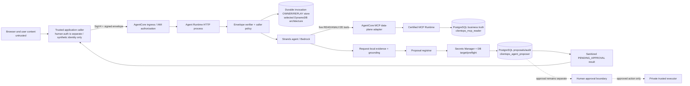

# Phase 5.2.3-B — Trusted Runtime Integration Architecture

Status: B0 architecture merged as PR #11. B1 offline signed invocation contract merged as PR #12. B2 architecture selects DynamoDB as the durable invocation OWNER/REPLAY store; B2 implementation is not authorized by this decision.
Architecture baseline: branch `phase/5.2.3-b0-trusted-runtime-architecture`, HEAD `49426c6777053877acc9c53f8fdfa78dc080add5`.
Gate A: complete offline-only, non-deployable, merged as PR #10.

## 1. Purpose and entry baseline

Gate B defines the trusted caller, invocation integrity, durable retry ownership, AWS AgentCore MCP data-plane adapter, proposer secret/database boundary, fail-closed composition, and offline integration evidence needed before any later live gate. B0 architecture is merged. B1 is explicitly authorized for offline contract implementation only. B2–B5 and Gates C–F remain separately gated. This document grants no AWS provisioning/deployment, database changes/live proposal writes, production identity, Memory/OIDC, or model authority.

Accepted prior constraints are recorded in ADR 0006, `docs/PHASE5_CONTRACTS.md`, and `docs/PHASE5_2_RUNBOOK.md`. B1 approved decisions are: JWS Compact serialization, ES256, RFC 8785 JCS, explicit `kid` public-key allowlist with key-to-caller authorization, dedicated trusted application caller, server-owned synthetic staging identity, signed `NEW`/`RETRY` intent, 120-second maximum lifetime, and 30-second maximum clock skew. B1's offline signed invocation contract is merged as PR #12 and does not activate enforcement. The user-approved B2 architecture decision dated 2026-10-16 selects DynamoDB as the isolated durable OWNER/REPLAY store. This selection authorizes documentation only: B2 implementation, AWS provisioning, IAM/KMS configuration, runtime activation, deployment, and remote invocation remain separately gated.

## 2. Current code inventory and seams

| Area            | Present in repository                                                                                         | Missing for Gate B                                                                                     |
| --------------- | ------------------------------------------------------------------------------------------------------------- | ------------------------------------------------------------------------------------------------------ |
| Contracts       | Strict V1 request/response plus B1 strict signed envelope schema in `packages/contracts/src/agent-runtime.ts` | Runtime ingress activation and durable replay/owner store                                              |
| Caller policy   | Existing offline Gate A policy plus B1 signer/verifier primitives                                             | Verified AWS caller source and durable distributed store; injected principal is not proof              |
| Ownership       | `InMemoryCallerOwnershipStore` for offline tests                                                              | Durable conditional first-write-wins adapter and restart/concurrency evidence                          |
| HTTP            | `server.ts`: `/ping`, `/invocations`, body bounds, browser Origin rejection                                   | Trusted ingress binding; JSON body alone provides no AWS principal proof                               |
| MCP adapter     | `agentcore-mcp.ts`: six-tool exact catalog check, five model-facing tools, protocol `2025-11-25`              | `main.ts` uses `Phase521UnboundAgentCoreInvoker`; concrete SDK/data-plane binding                      |
| Composition     | `handler.ts` integrates agent, evidence/grounding and optional registrar                                      | Startup composition currently does not bind trusted caller, durable store, MCP invoker, or registrar   |
| Proposer        | `proposal-registrar.ts`: preflight, transaction, `registerActionProposal`, request ID correlation             | Production composition and approved staging secret source/role wiring; no privilege expansion          |
| Database policy | `@clientops/data` workload target and privilege preflight; MCP has Secrets Manager hydration                  | Verify proposer workload secret retrieval and exact target/preflight in a later authorized gate        |
| IAM design      | Candidate/guardrail documents and tests                                                                       | Effective AWS roles/trust policy and actual permissions are not established by offline candidate tests |

Inspection is source-level only. No AWS or database capability is inferred from planning documents or candidate policy fixtures.

## 3. Trust boundaries

SigV4 authenticates and authorizes the AWS service caller at ingress. The signed envelope is the proposed application-level proof of the logical request and trusted certification identity. The runtime must not treat unverified body fields, arbitrary headers, AgentCore transport session IDs, or assumed principal forwarding as caller identity. AgentCore principal-forwarding behavior remains a live verification question.

## 4. Invocation and replay lifecycle

This lifecycle is the planned post-B2 flow, not B1 behavior. B1 does not connect the verifier to HTTP or agent execution and does not provide durable ownership or replay consumption.

1. Trusted application resolves the staging certification organization/actor, generates UUID request/session IDs for a new logical invocation, validates strict V1 input, computes canonical payload fingerprint, assigns exact runtime/environment audience and timestamps, sets signed intent `NEW`, and signs the complete envelope with a caller key. It sets `RETRY` only from trusted server-side retry state for an existing logical request; neither browser nor untrusted JSON selects intent or authoritative IDs.
2. Application invokes only the configured runtime using AWS IAM/SigV4. Browser receives no AWS authority and cannot construct an accepted envelope.
3. Ingress enforces IAM authorization. A future runtime binding validates envelope encoding/signature against an allowlisted protected-header `kid` and configured `callerId`; it verifies audience, identity, timestamps, expiry, replay ID format, and recomputed fingerprint. It does not trust a principal claim unless sourced by a verified platform channel.
4. For `NEW`, runtime atomically consumes the replay ID and calls Gate A's `getOrCreate` insert-if-absent ownership operation. If that request ID already exists, reject as a conflicting NEW; do not turn it into an implicit retry. For `RETRY`, runtime calls Gate A's `find`/strongly consistent lookup, verifies all immutable owner fields, then atomically consumes the fresh replay ID subject to the owner still existing and matching. RETRY never creates an owner; an unknown valid retry UUID is rejected with no ownership or replay-marker insertion. Both paths reject caller, identity, session, or fingerprint conflict before agent work.
5. Runtime runs the agent with exactly five business tools, captures evidence locally, validates grounding, and invokes proposal registration only for a valid `task.create` proposal.
6. Registrar uses `clientops_agent_proposer` after safe secret loading and exact database target/privilege preflight. PostgreSQL remains authoritative. Existing proposal correlation idempotency uses the same request ID.
7. Runtime returns the existing strict sanitized response. Approval/denial/execution remains outside this boundary.

An authorized `RETRY` is freshly signed with `intent=RETRY`, a fresh replay ID, and the original immutable logical request ID, caller, certification identity, session ID, and payload fingerprint. B2 must reject verbatim replay of the same signed envelope, including concurrent duplicates. Check that the existing owner matches before atomically consuming the RETRY replay ID; unknown RETRY writes neither an owner nor a replay marker. Replay-ID consumption and corresponding ownership create/verification must be durable and atomic across processes. Retain replay-ID duplicate records at least as long as their envelopes can be accepted, including the approved 30-second clock skew; the concrete retention duration remains unresolved. Crash, timeout, ambiguous write, or store outage fails closed before agent/proposer work. No in-memory replay protection is allowed. TTL expiry, delayed cleanup, or ordinary record deletion must never allow reassignment of an old logical request ID; preserve an owner record or permanent non-reassignment tombstone/key reservation. Concrete retention, TTL, schema, key design, and response replay policy remain later approval decisions. The envelope lifetime and maximum clock skew are fixed at 120 and 30 seconds respectively. Transport session identity is correlation only.

The lifecycle above describes the planned post-B2 invocation flow. B1 implements only offline schema, canonicalization, signer/verifier, and ownership decision contracts. No replay ID is consumed and no runtime handler or HTTP ingress is connected; verification alone is not replay protection or authorization to execute the agent.

## 5. Caller authentication and envelope contract

Authentication layers are separate:

- **AWS layer:** SigV4/IAM authorizes the invoking workload to call this runtime. Effective service behavior and policies require AWS verification.
- **Application layer:** asymmetric signature binds caller identity, exact audience, synthetic organization/actor, logical request/session IDs, canonical payload fingerprint, issued-at/expiry, and unique replay ID. Runtime verifies against configured public keys and caller policy.
- **Human layer:** no production identity implementation is authorized. Until separately gated, use only the configured synthetic certification pair; browser claims cannot select it.

The B1-approved envelope fields and verification rules are specified in ADR 0007, including signature-bound `intent=NEW|RETRY`, JWS Compact ES256, RFC 8785, a 120-second maximum lifetime, and 30-second maximum clock skew. The offline verifier uses a public-key allowlist with at most two configured keys for bounded current/retiring overlap; unknown, revoked, absent, malformed, or unavailable key fails closed. No unsigned fallback. B1 does not persist or atomically consume replay identifiers and does not authenticate AWS or human identity. Production key custody and any future KMS signing remain unapproved.

Gate B does not implement or claim a production human authentication path. Staging certification organization and actor are synthetic and selected only by trusted server configuration. Browser/user identity claims cannot set them. Identity-provider integration remains a separate future gate.

## 6. Durable ownership model and atomicity

Architectural decision (2026-10-16): DynamoDB is the dedicated durable OWNER/REPLAY store, isolated from PostgreSQL business, proposal, approval, task, and audit authority. Logical ownership identity is scoped by runtime/environment and logical `requestId`. Immutable ownership attributes include caller, certification organization and actor, stable request and session IDs, and canonical payload fingerprint. `NEW` uses atomic conditional first-write-wins ownership creation; existing ownership cannot be reassigned. `RETRY` is find-only for ownership; unknown RETRY creates neither ownership nor a replay marker. RETRY requires strongly consistent owner lookup or an equivalently safe transactional verification; stale reads cannot authorize invocation. Signed replay IDs are consumed durably and atomically with the corresponding ownership decision. Verbatim and concurrent replay attempts, owner identity mismatches, immutable request-field mismatches, storage outages, conflicts, timeouts, uncertain writes, and ambiguous outcomes fail closed. Verify owner existence and every immutable owner field before consuming a retry replay ID. Bound conflict retries, timeouts, and total invocation latency. No stale-read or in-memory fallback may authorize invocation. TTL is cleanup only: expiry or deletion must never permit reuse of an old logical request ID. Target one approved staging region initially; cross-region coordination is not assumed. Do not persist raw prompts, credentials, signatures, tool outputs, or provider errors. PostgreSQL remains the authoritative business system of record. No cross-store transaction or exactly-once execution guarantee is claimed.

Bound conflict retries, timeouts, and total invocation latency. No in-memory fallback. Ownership and replay protection must survive process restart and concurrent instances. Outage, throttling beyond bounded retry, stale/unavailable read, malformed item, crash, timeout, or ambiguous claim outcome fails closed and triggers no model or proposer work. A crash after a committed NEW claim leaves a retryable owned request; uncertain replay consumption rejects the current attempt, and a later fresh envelope must safely resolve durable state. Ownership must never be reassigned after TTL expiry, delayed cleanup, or metadata deletion; retain the owner or permanent tombstone/key reservation. Proposal transaction remains a separate PostgreSQL commit; recovery reuses the same request ID and relies on existing database-enforced correlation idempotency. There is no distributed transaction claim. Offline integration evidence must demonstrate duplicate proposal/audit behavior at injected failure points; any gap requires a changed design and explicit approval.

PostgreSQL ownership would require schema/table and grant changes and could expand the frozen proposer role. DynamoDB is selected to isolate invocation retry coordination from PostgreSQL business authority and avoid coupling ownership to proposer privileges. This architectural selection does not authorize provisioning, IAM grants, KMS setup, database changes, or implementation.

## 7. AWS AgentCore SDK adapter

Planned interface boundary (not implemented): an injected `AgentCoreRuntimeInvoker` should accept the frozen runtime ARN/qualifier, operation, MCP method/name, protocol/content negotiation, and bounded payload; return status/content type/body plus only sanitized metadata. The adapter must bind only the configured certified MCP Runtime ARN and qualifier, enforce request/response size and timeout bounds, use AWS SDK credentials from the workload role (no static keys), and validate HTTP status, content type, single SSE message, JSON-RPC envelope, schema, and catalog.

Expected failures include access denied/signature failure, wrong ARN/qualifier/region, missing or expired credentials, throttling, timeout, transport errors, non-200 status, unexpected content type/SSE framing, malformed JSON-RPC, MCP error, schema mismatch, catalog drift, and oversized response. All errors map to bounded internal codes; do not log raw SDK exception, request/response payload, tool arguments/output, SQL, credentials, or stacks. Retry only safe read/list operations under bounded policy; tool-call retry semantics require separate review. Catalog must equal the certified six tools and model still sees exactly the five business tools.

## 8. Proposer registrar and secrets boundary

Existing `createPostgresProposalRegistrar()` obtains the configured data pool, runs `assertAgentProposerDatabasePrivileges`, constructs repositories, uses a transaction, and invokes `registerActionProposal` with `requestId` as correlation ID and request-local evidence resolver. It rejects replay results no longer pending approval. Preserve this trust unit and role ceiling.

Proposed startup composition loads only the exact configured proposer DB secret via workload IAM, validates region/ARN and secret shape, passes it to existing explicit `CLIENTOPS_DATABASE_TARGET=staging` / `CLIENTOPS_DATABASE_WORKLOAD=agent-proposer` target checks, and completes proposer privilege preflight before readiness. Secret bytes stay in process memory only as needed; never log them or expose in public errors. No service-role credential, generic remote override, MCP reader credential, or browser variable is allowed. Secret ARN, IAM resource scope, loading library, rotation behavior, and binding are unresolved until approved and later verified. Do not reuse the MCP secret or role by assumption.

Duplicate prevention spans ownership and PostgreSQL separately: the future owner store prevents cross-caller/logical-request collision; PostgreSQL correlation uniqueness and transaction prevent duplicate proposal/audit effects. Failure tests must prove this with injected crashes and ambiguous commits. If current DB behavior cannot prove one proposal and the permitted audit events per request, stop for design review; B1 authorizes no database schema or privilege change.

## 9. Fail-closed behavior

Startup must fail readiness/listening if required env/config, envelope keys, ownership adapter, AWS invoker, MCP catalog, proposer secret, exact staging target, or proposer preflight is absent/invalid. `GET /ping` reports healthy only after required dependencies are ready. No placeholder/unbound adapter may be advertised as healthy for remote work.

Invocation rejects before agent work on ingress/authentication failure, invalid envelope, unknown/expired/replayed envelope, unknown retry, owner/payload conflict, ownership-store uncertainty, catalog mismatch, or unavailable required dependency. Do not fall back to in-memory ownership, unsigned identity fields, direct MCP URL, alternate database, or broader tool list. Public errors are bounded and sanitized. Storage and proposer outages create no synthetic successful result and no automatic approval.

## 10. IAM role/permission matrix (design only)

| Principal                                 | Proposed minimum                                                                                                                                                    | Must not have                                                                                                   |
| ----------------------------------------- | ------------------------------------------------------------------------------------------------------------------------------------------------------------------- | --------------------------------------------------------------------------------------------------------------- |
| Trusted application caller                | Invoke exact Agent Runtime; sign through approved key mechanism                                                                                                     | MCP invocation, proposer DB, broad `bedrock-agentcore:*`, key administration                                    |
| Agent Runtime role                        | Invoke exact MCP Runtime; read exact proposer DB secret; ownership-table operations limited to exact table/key use; required model invoke if separately established | IAM policy/key administration, secret listing, unrelated secrets, business DB mutation beyond proposer identity |
| MCP Runtime role                          | Existing certified secret read for MCP DB URL; read-only MCP database identity                                                                                      | Agent Runtime ownership table, proposer secret/DB identity, approval/execution/task mutations                   |
| Key administrator (separately controlled) | Provision/rotate/revoke signing key according to approved process                                                                                                   | Agent invocation, database access, runtime application duties                                                   |
| Deployment operator (later gate)          | Only explicitly approved deployment actions                                                                                                                         | Data-plane business writes, approval/execution authority                                                        |

Exact actions, resource ARNs, trust conditions, resource policies, conditions, and permission boundaries are unset. Candidate policy tests are not effective-IAM verification. No roles/policies are created in B0.

## 11. Threat and negative-test map

| Threat                                   | Required mitigation                                                            | Offline negative evidence                                               | Later AWS evidence                                                            |
| ---------------------------------------- | ------------------------------------------------------------------------------ | ----------------------------------------------------------------------- | ----------------------------------------------------------------------------- |
| Forged principal                         | Only verified ingress identity plus signed caller allowlist                    | Reject injected/forged context and body principal                       | Prove SigV4/resource policy caller identity and principal forwarding behavior |
| Arbitrary browser/client identity claims | Server derives synthetic identity; signed envelope; reject Origin/browser path | Alter actor/org/body fields; signature fails                            | Direct/browser invocation denied at actual ingress                            |
| Cross-caller retry                       | Owner bound to caller ID                                                       | Caller B cannot reuse A request ID                                      | Two separately authorized callers against durable store                       |
| Unknown valid retry UUID                 | `RETRY` uses find-only and never creates                                       | Unknown ID rejected; assert no ownership insertion or agent call        | Persisted unknown lookup behavior                                             |
| Untrusted intent claim                   | Signed envelope intent set by trusted caller                                   | Browser/body cannot set or override NEW/RETRY                           | Verify deployed signer boundary and ingress                                   |
| Changed canonical payload                | Canonical fingerprint signed and matched to immutable owner                    | Canonical vector + changed field/property ordering/optional value cases | Same check through deployed signer/verifier                                   |
| Replay after expiry                      | Timestamp policy + durable replay/ownership state                              | Expired envelope rejected                                               | Clock behavior and expiry policy under actual deployment                      |
| Concurrent first writes                  | Conditional first-write-wins, consistent conflict read                         | Parallel race yields one owner; conflicts bounded                       | Multi-instance DynamoDB race and consistency                                  |
| Duplicate replay ID / verbatim envelope  | Durable atomic replay-ID consume and duplicate detection                       | Concurrent duplicate rejected; crash/timeout/outage fail closed         | Multi-instance replay race and durable behavior                               |
| Restart/crash during ownership creation  | Durable record, stable request ID, crash-point recovery                        | Restart adapter; inject before/after claim                              | Runtime restart/scale-out against real store                                  |
| TTL/deletion reassignment                | Owner or tombstone/key reservation survives cleanup                            | Expiry/deletion cannot permit old request ID to be claimed              | Verify configured retention/cleanup behavior                                  |
| Ownership store outage                   | Fail closed, no agent/proposer                                                 | Timeout/throttle/error => no downstream calls                           | IAM/network/outage behavior and alarms                                        |
| Envelope tampering/audience mismatch     | Signature covers all fields; exact audience                                    | Mutate each field; reject wrong audience                                | Deployed key/audience configuration                                           |
| Missing/rotated verification key         | Key ID allowlist, overlap/revocation process, no fallback                      | Missing/unknown/retired key rejected; valid overlap accepted            | Actual key/KMS lifecycle and policy                                           |
| Unexpected MCP catalog                   | Exact six remote, five model-facing                                            | Add/remove/change tool => startup/invocation fail                       | Actual certified catalog at pinned runtime                                    |
| Secret leakage / SQL exception leakage   | Never log raw errors/secrets; mapped public errors                             | Inject secret-bearing SDK/DB exceptions and scan output/log capture     | Cloud logs/traces and Secrets Manager behavior                                |
| Excessive IAM permissions                | Narrow roles and resource scope                                                | Static policy candidate guardrails only                                 | IAM Access Analyzer/effective policy review and negative calls                |
| Untrusted caller bypass                  | Require envelope and verified ingress before handler                           | Invoke handler with absent/invalid auth; no downstream calls            | Direct endpoint bypass test and network policy verification                   |
| Duplicate proposal/audit events          | Stable owner request ID + DB transaction/correlation uniqueness                | Parallel/retry/crash tests assert one proposal and allowed event counts | Staging DB transaction/replay certification (separate approval)               |

Offline tests prove deterministic application logic with fakes/local stores and injected faults. They do not prove AWS IAM/SigV4, KMS, AgentCore forwarding, DynamoDB service semantics, secrets IAM, deployed catalog, network reachability, or database role grants.

## 12. Work packages B1–B5 (separately approved)

| Package | Scope                                                                                                                         | Acceptance criteria                                                                                                                                                                |
| ------- | ----------------------------------------------------------------------------------------------------------------------------- | ---------------------------------------------------------------------------------------------------------------------------------------------------------------------------------- |
| B1      | Offline envelope contract, canonicalization, signer/verifier, signed NEW/RETRY intent, and ownership decision interfaces      | Fixed vectors; signed fields/intent; NEW claim versus RETRY lookup contract; unknown RETRY cannot create ownership; no committed private key. Verbatim replay protection is absent |
| B2      | Implement and verify the approved DynamoDB durable OWNER/REPLAY adapter and retry semantics (separate authorization required) | Atomic first-write wins and replay-ID consumption; durable lookup; bounded conflicts; restart/concurrency/crash/outage evidence; no raw payload storage or ID reassignment         |
| B3      | Concrete AgentCore MCP data-plane adapter and startup composition                                                             | Exact runtime/qualifier, SDK error mapping, six-tool catalog exact, five model-facing; all required bindings fail startup                                                          |
| B4      | Proposer secret loading and integration/failure recovery                                                                      | Exact secret resource; existing target/preflight; frozen proposer role; sanitized failures; duplicate proposal/audit evidence                                                      |
| B5      | Offline integration certification package                                                                                     | Full threat matrix negative tests, restart/concurrency/crash evidence, reports, exact-head offline CI; still not deployable                                                        |

Package boundaries and sequence are proposed. Any DB/schema, trust-boundary, identity, role, action, Memory/OIDC, or deployment change triggers stop and explicit approval.

## 13. Offline-to-live gates and stop conditions

### B1.2 offline contract hardening

B1's signed transport applies explicit UTF-8/encoding ceilings: a canonical
strict V1 request is limited to 16,000 bytes, a canonical JWS claims payload to
18,432 bytes, and the complete compact JWS to 32,768 ASCII characters (with
each segment limited to 24,576 characters). These B1 wire limits are narrower
than the V1 schema for multibyte or escaped messages; the signer rejects an
oversize request with a sanitized error. They do not change the frozen Gate A
fingerprint contract.

B1 ownership support is an advisory intent plan and immutable retry comparison
only. The B1 API does not authorize execution or perform ownership writes.
Future B2 integration must consume replay IDs atomically with the durable
conditional NEW claim or verified find-only RETRY decision. Server-side retry
intent selection and signature-verified ownership integration remain future
authorized work. An unknown RETRY must remain read-only and can never create an
owner.

- **B0 (complete, PR #11):** architecture and governance documentation.
- **B1 (merged as PR #12):** offline contract work only. Cryptographic signature checks do not prove AWS IAM identity and do not prevent verbatim replay. Atomic replay consumption, durable first-write-wins ownership, crash recovery, and durable idempotency remain unimplemented B2 work.
- **B2 architecture (documented here):** DynamoDB OWNER/REPLAY store selection is approved. B2 implementation remains separately gated and is not authorized by this documentation decision.
- **B2 implementation and B3–B5:** require separate explicit authorization. Completing B5 does not authorize cloud deployment.
- **Gate B:** offline trusted runtime integration, including separately approved B1–B5 implementation and offline verification only. No image build, provisioning, deployment, remote invocation, or live proposal writes.
- **Gate C:** image build, provenance, and scanning; this does not authorize AWS provisioning.
- **Gate D:** separately authorized provisioning of staging ECR, IAM, and logging resources; certify scope.
- **Gate E:** deploy the digest-pinned AgentCore HTTP Runtime with MMDSv2 and constrained ingress, after required prior gates and separate authorization.
- **Gate F:** remotely certify caller authorization, health, tool isolation, and sanitized errors without live proposal writes, after required prior gates and separate authorization.
- **Phase 5.2.4:** separately approved live proposal, retry, and tenant-isolation certification. This is not part of Gate F.

Preserve these gate scopes and prerequisite sequencing; do not merge implementation, provisioning, deployment, and certification. Stop on failed baseline, conflicting governing docs, need for an unapproved trust-boundary decision or database change, unverified principal semantics, leaked sensitive errors, catalog drift, overbroad IAM, uncertain ownership/replay writes, or any unexpected tracked file change. Never infer provisioning, deployment, or live-write authority from green CI.

## 14. Risks and unresolved approval items

Risks include compromised trusted caller/key, incorrect canonicalization, clock skew/expiry mismatch, stale public-key distribution, replay-ID and owner retention behavior, store unavailability, ambiguous cross-store crash outcomes, SDK/AgentCore behavior drift, excess permissions, and proposal/audit duplicate gaps. DynamoDB is architecturally selected, but implementation, provisioning, KMS key creation/use, caller deployment, runtime bindings, IAM/cloud/deployment remain unapproved future work. See ADR 0007 for decision status and alternatives.
